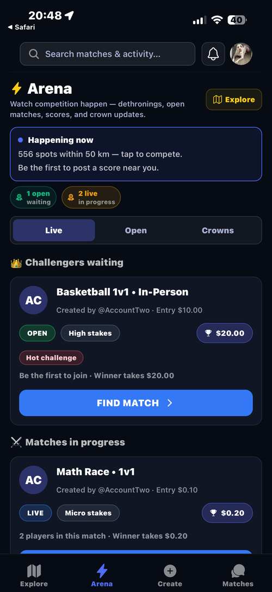
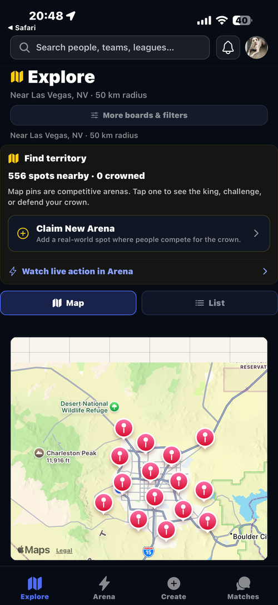
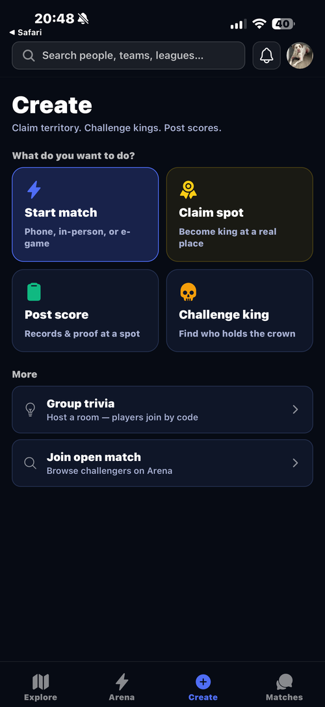
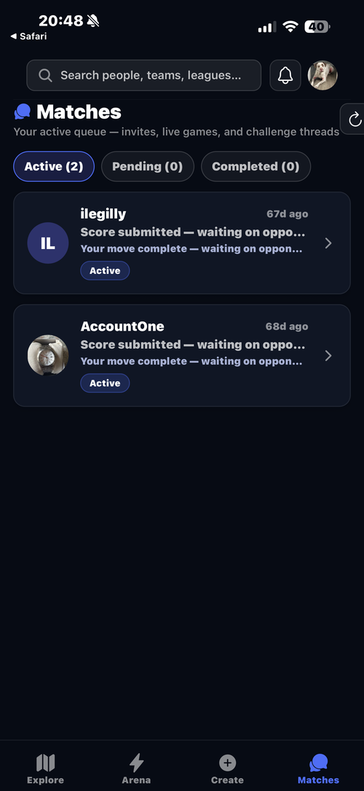

# Gaming App

Competition-based social gaming platform focused on skill challenges, rankings, and location-based matchups.

## Screenshots

<p>
  
  
  
  
</p>

## Run on your phone

```bash
npm install
npm start
```

`npm start` runs Metro on your **LAN IP** with the **development build** (this app uses native modules; Expo Go is not supported).

1. Install the **Arena dev build** on the phone (EAS `development` profile or `expo run:android` / `expo run:ios`).
2. Phone on the **same Wi‑Fi** as the PC (turn off cellular for the test).
3. On the phone browser, open `http://YOUR_PC_IP:8081/status` — must show `packager-status:running`.
4. Open the **Arena dev app** and scan the QR from the terminal (**not** the iOS Camera — that shows “not a usable code”). Second phone? See [docs/DEV_SECOND_DEVICE.md](docs/DEV_SECOND_DEVICE.md).
5. Windows: once run `npm run firewall:metro` in **Administrator** PowerShell if step 3 fails.

- Expo Go (limited, may break): `npm run start:go`
- Simulator on this PC only: `npm run start:localhost`
- Wrong IP: set `REACT_NATIVE_PACKAGER_HOSTNAME=192.168.x.x` in `.env`

After adding `expo-dev-client` to `app.json`, rebuild the dev app once (`eas build --profile development` or `expo run:android`).